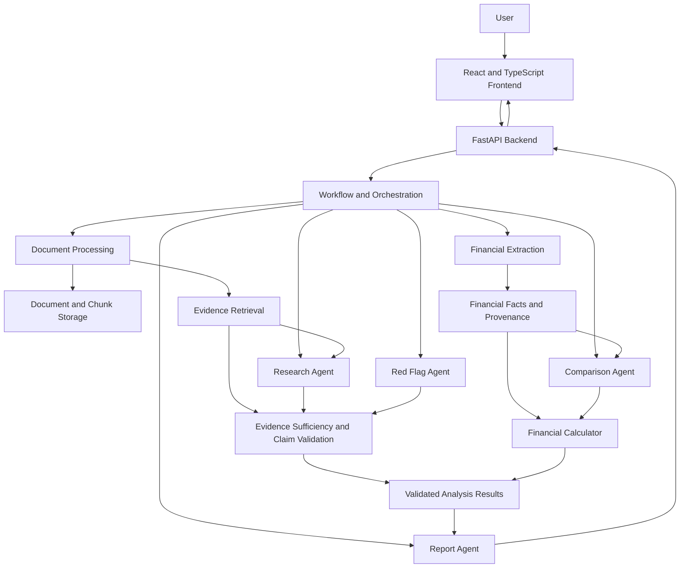
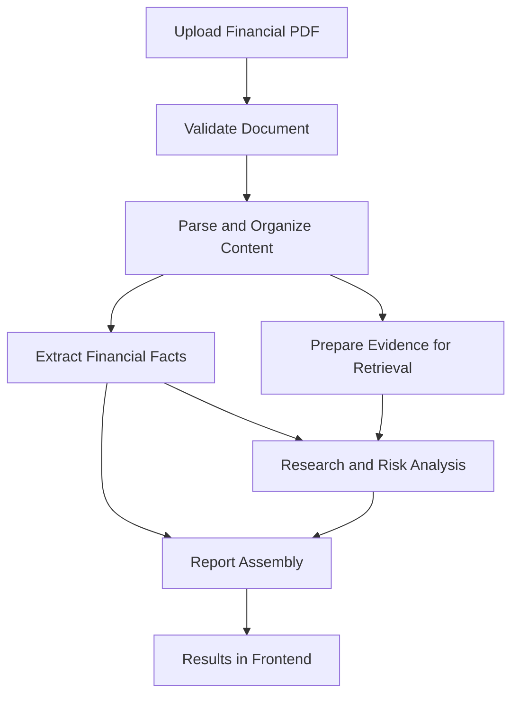
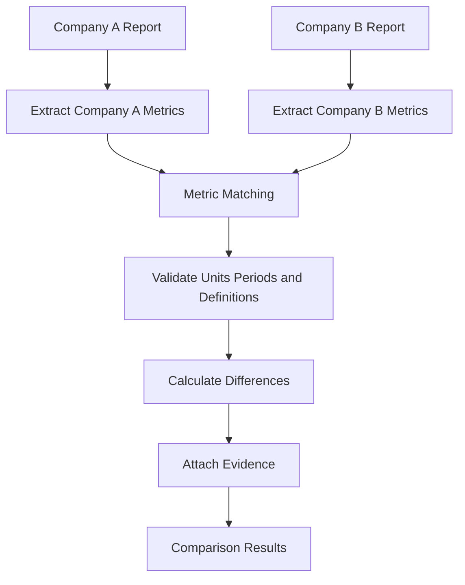
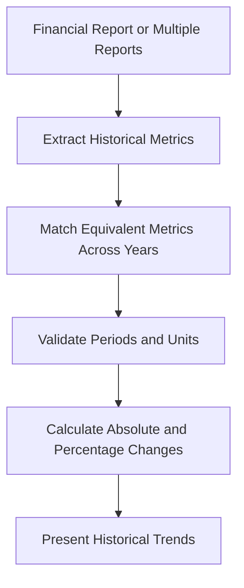

# Architecture — FinSight AI
## AI-Powered Multi-Agent Financial Analysis System

**Version:** 1.0  
**Status:** Draft — verify implementation details against the current codebase.

---

## 1. Architecture Overview

FinSight AI follows a modular full-stack architecture. The frontend communicates with a FastAPI backend, which coordinates financial document processing, evidence retrieval, financial analysis, and report generation.

The system separates responsibilities into specialized agents and supporting services. This separation makes the application easier to test, maintain, and extend.

### Main architectural layers

1. Frontend web application.
2. Backend API layer.
3. Workflow and orchestration layer.
4. Document processing and financial extraction.
5. Evidence retrieval and validation.
6. Financial research and risk analysis.
7. Financial comparison and calculation.
8. Report generation.
9. Testing, configuration, and supporting utilities.

The architecture must reflect actual implemented modules. Planned services must not be treated as active production dependencies without verification.

---

## 2. Technology Stack

| Layer | Technology |
|---|---|
| Frontend | React, TypeScript, Vite |
| Backend | Python, FastAPI |
| API schemas | Pydantic / FastAPI request and response models |
| Financial orchestration | Python modules under `backend/orchestration/` |
| Vector retrieval | ChromaDB in the existing agent workflow, subject to implementation verification |
| AI reasoning | Configured LLM integration, including Gemini where used |
| Testing | pytest and relevant API/frontend tests |
| Version control | Git and GitHub |
| Frontend development server | Vite |

**Configuration note:** Verify the actual database, embedding provider, file-storage strategy, and production deployment configuration before documenting them as confirmed dependencies.

---

## 3. High-Level System Architecture



This is a conceptual view of the system's responsibilities. Exact call relationships and data stores must be confirmed from the implementation.

---

## 4. Frontend Architecture

### Location

```text
front end/
├── index.html
├── package.json
├── vite.config.ts
└── src/
    ├── App.tsx
    ├── main.tsx
    ├── components/
    ├── lib/
    └── pages/
```

### Responsibilities

The frontend provides the user-facing interface for financial analysis.

Expected capabilities include:

- Uploading financial reports.
- Viewing analysis results and financial metrics.
- Asking research questions.
- Reviewing potential financial risks.
- Comparing companies or reporting periods.
- Viewing reports and supporting citations.
- Displaying loading, empty, and error states.

### Main interface modules

| Module | Responsibility |
|---|---|
| `App.tsx` | Application composition and routing |
| `components/` | Shared interface components and visualizations |
| `lib/api.ts` | Frontend API communication |
| `lib/types.ts` | Shared TypeScript data contracts |
| `lib/formatters.ts` | Formatting financial values and presentation data |
| `lib/AppContext.tsx` | Shared frontend state |
| `pages/WorkspacePage.tsx` | Workspace and document workflow |
| `pages/OverviewPage.tsx` | Analysis overview |
| `pages/FinancialsPage.tsx` | Financial metrics |
| `pages/ResearchPage.tsx` | Research questions and answers |
| `pages/RiskPage.tsx` | Risk findings |
| `pages/ComparisonPage.tsx` | Financial comparisons |
| `pages/ReportPage.tsx` | Generated report interface |
| `pages/HistoryPage.tsx` | Analysis history |
| `pages/SettingsPage.tsx` | Application settings |

The presence of a page does not by itself prove that its backend workflow is fully operational.

---

## 5. Backend API Architecture

### Location

```text
backend/
├── api.py
├── __init__.py
└── orchestration/
```

### Entry point

The FastAPI application is defined in:

```text
backend/api.py
```

For local development, the application is started with:

```powershell
python -m uvicorn backend.api:app --host 127.0.0.1 --port 8000 --reload
```

The frontend development server runs separately:

```powershell
cd "front end"
npm run dev
```

### Responsibilities

The backend API is responsible for:

- Receiving frontend requests.
- Validating incoming data.
- Handling document uploads.
- Invoking analysis workflows.
- Returning structured responses.
- Handling expected errors.
- Exposing the configured health endpoint.
- Coordinating communication between the API and analysis components.

The exact routes, request schemas, response schemas, and persistence behavior should be documented from `backend/api.py` and its imported modules rather than inferred from frontend page names.

---

## 6. Orchestration Architecture

### Location

```text
backend/orchestration/
├── claim_validator.py
├── evidence_retrieval_service.py
├── evidence_sufficiency.py
├── financial_calculator.py
├── financial_fact_extractor.py
├── question_analyzer.py
├── research_reasoning_engine.py
└── research_state.py
```

These modules provide supporting capabilities for evidence-oriented financial analysis.

### 6.1 Question Analyzer

**Module:** `question_analyzer.py`

Responsible for analyzing incoming research questions and identifying the information required to answer them.

Expected responsibilities include determining the question's intent and guiding subsequent retrieval and reasoning.

### 6.2 Evidence Retrieval Service

**Module:** `evidence_retrieval_service.py`

Responsible for retrieving potentially relevant evidence from the configured document retrieval system.

Retrieval should respect the applicable document and analysis scope to prevent unrelated reports from influencing the result.

### 6.3 Evidence Sufficiency

**Module:** `evidence_sufficiency.py`

Responsible for assessing whether available evidence is sufficient to support a financial answer or claim.

When evidence is insufficient, the system should communicate uncertainty instead of manufacturing facts.

### 6.4 Claim Validator

**Module:** `claim_validator.py`

Responsible for validating financial claims against available evidence and applicable validation rules.

The goal is to reduce unsupported assertions and improve traceability.

### 6.5 Financial Fact Extractor

**Module:** `financial_fact_extractor.py`

Supports the extraction or structuring of financial facts used by the research and analysis workflow.

Its exact relationship with the main Extraction Agent must be verified from imports and function calls to avoid duplicating responsibilities.

### 6.6 Financial Calculator

**Module:** `financial_calculator.py`

Supports deterministic financial calculations, such as absolute changes and percentage changes, where the required inputs are available and comparable.

Calculations should validate numeric values, periods, units, and zero denominators.

### 6.7 Research Reasoning Engine

**Module:** `research_reasoning_engine.py`

Supports the reasoning stage of financial research using question context, retrieved evidence, and applicable validation rules.

It should not replace source evidence with unsupported model-generated values.

### 6.8 Research State

**Module:** `research_state.py`

Defines or manages state used during research processing.

The state contract should be explicit so that intermediate results, evidence, errors, and validation outcomes are passed consistently between stages.

---

## 7. Specialized Agents

### 7.1 Document Agent

**Purpose:** Prepare uploaded financial documents for analysis.

Responsibilities:

- Parse supported document content.
- Organize text and chunks.
- Maintain document identifiers and available page references.
- Attach metadata to retrieved content.
- Support document-scoped retrieval.

### 7.2 Extraction Agent

**Purpose:** Extract financial facts and metrics from source documents.

Common metrics include:

- Revenue.
- Operating income.
- Net profit.
- Total assets.
- Total liabilities.
- Equity.
- Earnings per share.
- Cash flow.
- Borrowings.

Extraction results should preserve financial periods, units, currencies, metric definitions, and source evidence where available.

### 7.3 Research Agent

**Purpose:** Answer questions about financial reports.

Responsibilities:

1. Understand the question.
2. Retrieve relevant evidence.
3. Assess evidence sufficiency.
4. Reason over the supported facts.
5. Validate claims.
6. Return an answer with source references and appropriate limitations.

### 7.4 Red Flag Agent

**Purpose:** Identify potential financial and operational risks.

Examples include debt concerns, declining profitability, liquidity concerns, adverse cash-flow patterns, and explicitly disclosed market or operational risks.

Risk conclusions must be grounded in report evidence. A generic mention of a risk-related term is not sufficient to establish that a risk exists.

### 7.5 Comparison Agent

**Purpose:** Compare compatible financial metrics between companies or financial periods.

Responsibilities:

1. Match equivalent financial metrics.
2. Validate reporting periods.
3. Check units, currencies, and definitions.
4. Calculate absolute and percentage changes.
5. Interpret metric direction appropriately.
6. Preserve company identity and supporting evidence.

The agent should not declare one company universally superior based on a single metric.

### 7.6 Report Agent

**Purpose:** Assemble analysis results into a structured report.

Potential sections include:

- Executive summary.
- Financial highlights.
- Key metrics.
- Historical changes.
- Company comparisons.
- Potential risks.
- Research findings.
- Evidence and source references.
- Limitations.

The final report should use validated analysis outputs and must not introduce unsupported financial claims.

---

## 8. Core Data Flow

### 8.1 Single-Company Analysis



The exact order and parallel execution of stages depend on the actual workflow implementation.

### 8.2 Company-to-Company Comparison



Each company's metrics and evidence must remain isolated until the comparison stage intentionally combines compatible observations.

### 8.3 Year-over-Year Comparison



Year-over-year analysis is valid only when the relevant periods and metric definitions can be compared appropriately.

---

## 9. Evidence and Provenance

Evidence traceability is a central architectural requirement.

Where available, each financial fact or claim should retain:

- Source document identifier.
- Page number or source location.
- Relevant text excerpt.
- Metric name and definition.
- Reporting period.
- Numeric value.
- Unit and currency.
- Validation status.

### Evidence rules

1. Do not treat model-generated values as source facts without verification.
2. Do not silently replace missing values with zero.
3. Do not combine evidence from unrelated documents.
4. Preserve conflicting observations rather than silently discarding meaningful differences.
5. Do not compare incompatible financial values without suitable normalization.
6. Make uncertainty and evidence limitations visible to downstream components.

---

## 10. Error Handling and Reliability

The application should handle errors at both the API and analysis layers.

Important cases include:

- Invalid or unsupported uploads.
- Unreadable or incomplete document content.
- Missing financial metrics.
- Conflicting extracted values.
- Insufficient research evidence.
- Incompatible comparison inputs.
- LLM service failures or rate limits.
- Retrieval errors.
- Report-generation failures.
- Invalid API requests.

Expected failures should produce understandable error responses and diagnostic logs without exposing secrets or unnecessary sensitive document content.

Retries and fallback behavior should be limited to operations where they are safe and appropriate.

---

## 11. Security Boundaries

Security requirements are documented in `SECURITY.md`.

Architectural requirements include:

- Validate uploaded files and enforce size limits.
- Keep credentials in environment configuration or a secret manager.
- Apply authorization checks wherever user-specific resources exist.
- Enforce document-level access and retrieval isolation.
- Treat document contents as untrusted input.
- Prevent prompt injection in uploaded reports from overriding system instructions.
- Avoid leaking source documents across analyses.
- Sanitize externally generated content before rendering it.
- Avoid exposing sensitive content in logs or error responses.

Authentication, authorization, and database-level access controls must be described according to their actual implementation.

---

## 12. Testing Architecture

Testing responsibilities are documented in `TEST_PLAN.md`.

Recommended test layers include:

### Unit Tests

Test individual modules such as:

- Financial extraction helpers.
- Evidence sufficiency.
- Claim validation.
- Financial calculations.
- Question analysis.
- Metric matching.
- Risk detection.

### Integration Tests

Test interactions between:

- FastAPI routes and workflow services.
- Document processing and retrieval.
- Research reasoning and claim validation.
- Extraction and comparison.
- Analysis results and report generation.

### End-to-End Tests

Validate complete workflows:

1. Upload a financial report.
2. Process and extract financial information.
3. Ask a question and verify evidence.
4. Review risk findings.
5. Compare companies or years.
6. Generate and inspect the report.

### Regression Tests

Retain test fixtures for known failures, including missing values, zero values, conflicting definitions, unsupported metrics, incompatible units, and document contamination.

---

## 13. Configuration and Deployment

### Local development

The frontend and backend run as separate processes.

Frontend:

```powershell
cd "front end"
npm install
npm run dev
```

Backend, from the repository root:

```powershell
python -m uvicorn backend.api:app --host 127.0.0.1 --port 8000 --reload
```

The frontend's Vite proxy configuration must target the correct backend address and port.

### Production deployment

The deployment configuration must specify:

- Frontend hosting.
- Backend hosting.
- Environment variables and secrets.
- LLM provider configuration.
- Document and vector storage.
- CORS settings.
- Logging and monitoring.
- Persistent storage requirements.

Do not assume that local filesystem storage or development server settings are appropriate for production.

---

## 14. Architectural Constraints

- The frontend communicates with the backend API rather than directly invoking Python agents.
- Financial facts should be extracted and validated before being used in calculations.
- Research answers should be grounded in retrieved evidence.
- Company and document identities must remain explicit throughout the workflow.
- Financial calculations should use deterministic logic where possible.
- Agents should have clear responsibilities and explicit data contracts.
- External service dependencies should be configurable.
- New modules must include appropriate tests and documentation.

---

## 15. Open Verification Items

Before this document is considered implementation-verified, inspect the repository to confirm:

- The exact API routes and their request/response contracts.
- The actual document ingestion and parsing implementation.
- ChromaDB initialization, persistence, and metadata filtering.
- How the main Extraction, Research, Red Flag, Comparison, and Report Agents are invoked.
- Whether the orchestration modules are actively called by the production workflow or are auxiliary components.
- The actual database and file-storage configuration.
- The LLM and embedding provider integrations.
- Report and PDF generation paths.
- Authentication, authorization, and document ownership enforcement.
- The exact test coverage and successful test results.

Record discrepancies between intended and implemented behavior as follow-up tasks rather than documenting them as completed functionality.

---

## 16. Conclusion

FinSight AI is organized around a modular full-stack architecture that combines a React frontend, FastAPI backend, financial processing components, evidence-oriented research, risk detection, comparison, and report generation.

The primary architectural principles are modularity, traceability, document isolation, deterministic financial calculations, controlled error handling, and evidence-backed reasoning.

This document serves as the architecture baseline. It should be updated whenever implementation changes materially affect component responsibilities, API contracts, data flow, storage, security, or deployment.
